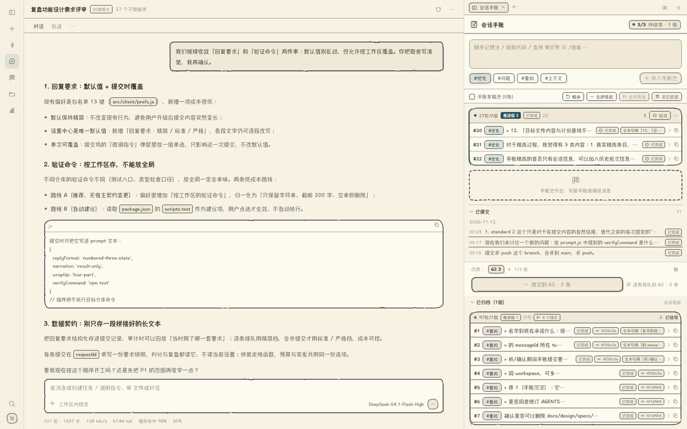
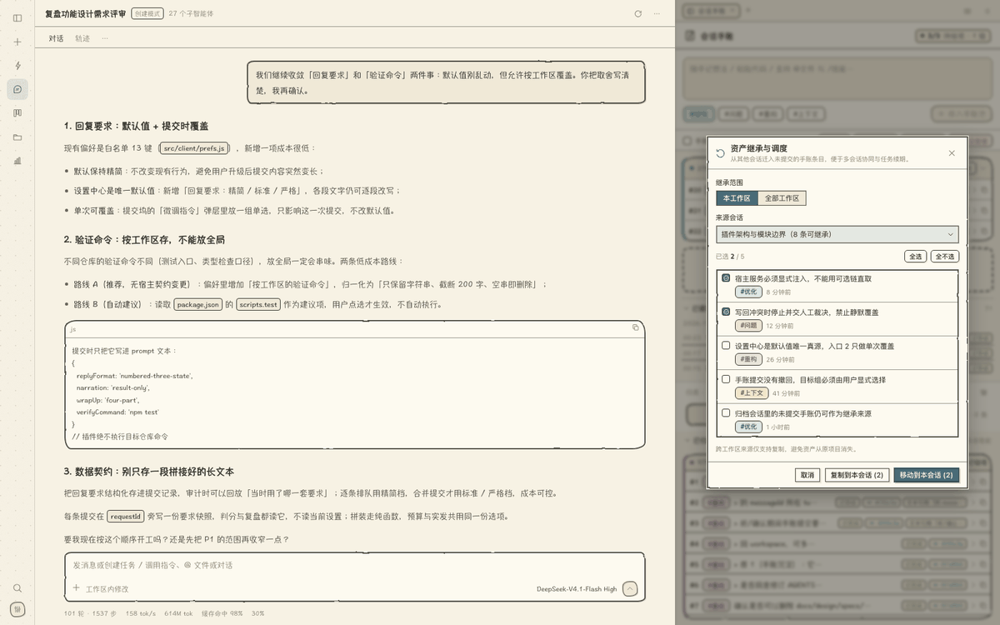
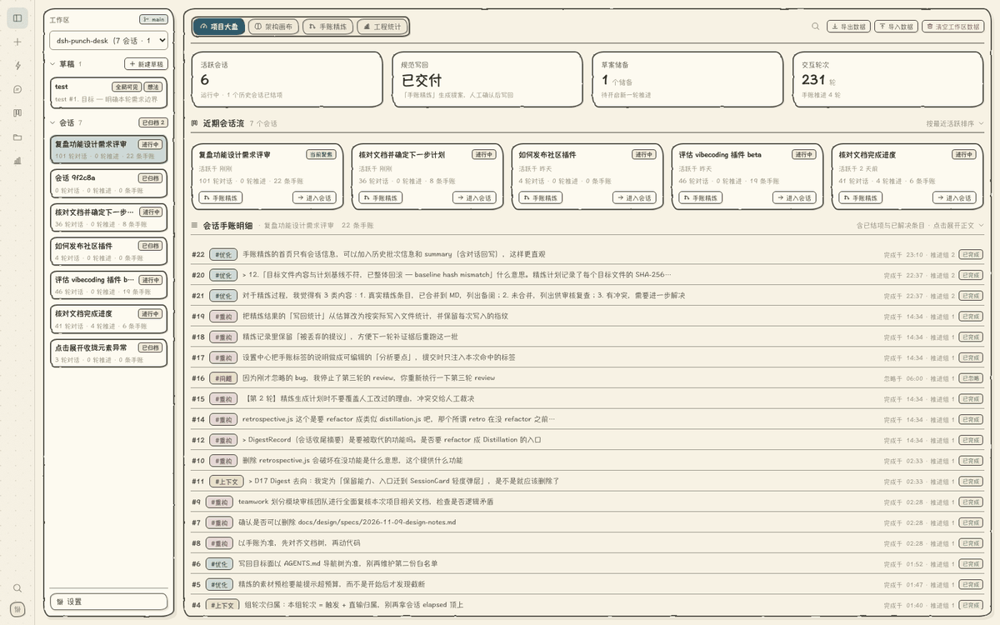
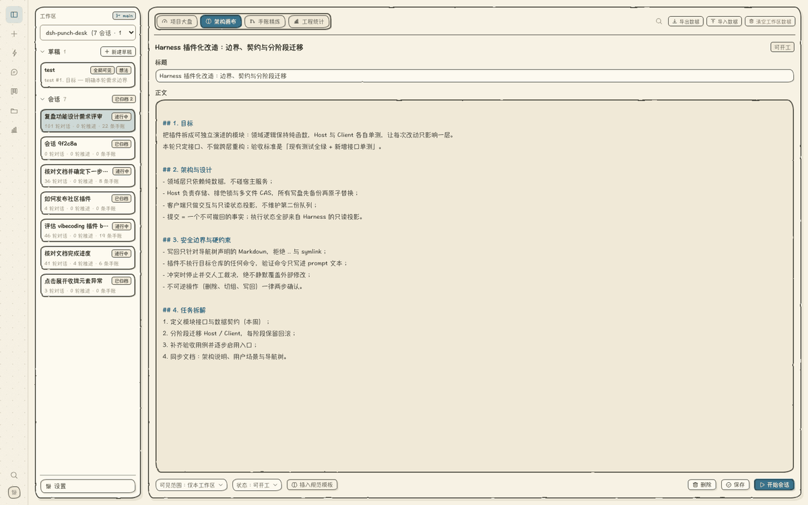
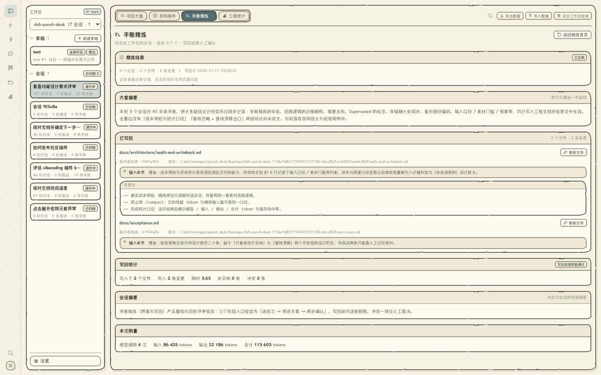
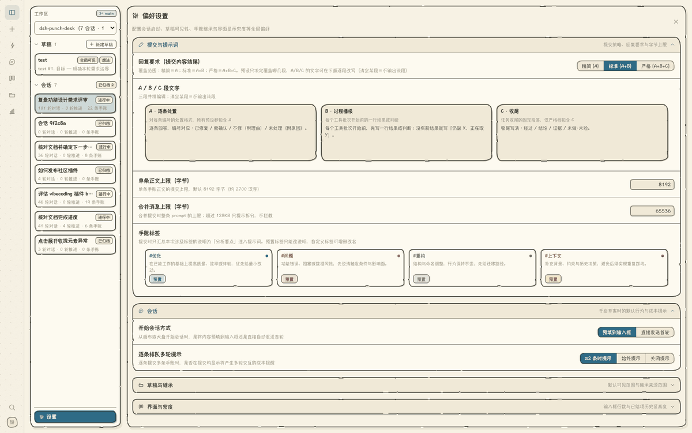

<p align="center">
  
</p>

<h1 align="center">Punch Desk</h1>

<p align="center"><b>Stop treating prompts as throwaway chat: turn sparks from a session into rules committed to your codebase.</b></p>

<p align="center">
  <a href="https://github.com/deepseek-ai/deepseek-harness">= 0.2.2-rc.1" src="https://img.shields.io/badge/DeepSeek%20Harness-%3E%3D0.2.2--rc.1-orange?style=flat-square"></a>
  <a href="https://github.com/Allencccc/dsh-punch-desk/blob/main/LICENSE"></a>
  
</p>

<p align="center">
  <a href="#install-and-get-started">Install & get started</a> ·
  <a href="#screenshots">Screenshots</a> ·
  <a href="#faq">FAQ</a> ·
  <a href="https://github.com/Allencccc/dsh-punch-desk/blob/main/README.md">中文</a>
</p>

## What it is

A session workbench plugin for DeepSeek Harness. It treats a prompt as a *working item* that moves engineering forward, instead of throwaway chat:

- **Before a session**: sketch goals, architecture, guardrails, and task breakdown on a 4-part spec canvas.
- **During a session**: jot ideas, capture key points from assistant replies as findings, refine them in a pool, then hand them to the model combined or one by one.
- **After a session**: extract decisions from resolved findings only (dismissed ones stay rejected-context, never written as rules), confirm them with two-level checkboxes, then write them back into the project documentation set (`docs/`, `AGENTS.md`, …; targets declared by the project's AGENTS.md documentation navigation) behind a multi-file CAS transaction; the feature is implemented (cancellation, maintenance window and idempotent fingerprints included) and end-to-end acceptance is in progress.

Two surfaces in one plugin:

- **Desk**: a global workbench from the left sidebar for multiple workspaces, drafts, session overview, and Finding Distillation (delivered, E2E acceptance passed).
- **Session Pane**: a right-side drawer for the current session's notes, findings pool, and active groups.

All data stays local. The plugin uploads nothing and needs no model API key of its own; it uses the model already configured in DSH.

## Screenshots



*Surface 2 · Session Pane: capture or jot a note into the draft pool, drag it into an Active Group, then submit combined or sequential; the header summarizes open work and execution state.*



*Asset inheritance: move or copy unsubmitted findings from other sessions, scoped to this workspace or all workspaces; cross-workspace sources are copy-only.*



*Surface 1 · Desk dashboard: workspace and session lists, four vitals (active sessions, write-back status, draft reserves, turns), recent session cards, and per-session finding detail.*



*Architecture canvas: a four-part draft (goal, architecture, safety boundaries, task breakdown) with a one-click spec template, then start a session by prefill or auto-send.*



*Finding Distillation: distil a session batch into documentation-update proposals, confirm them one by one, write back behind a multi-file CAS check, and keep the summary, write-back stats and usage.*



*Settings: reply-requirement presets with editable A/B/C sections, per-entry and combined byte limits, finding tags, plus session, draft and density preferences.*

## The two surfaces

### Surface 1 · Desk, the global workbench

- **Workspace switcher** with per-workspace sessions, drafts, and Git info;
- **Dashboard** for active sessions, documentation write-back status (delivered), draft reserves, and total interaction turns;
- **Spec canvas** with a 4-part template; a draft can boot a new session (prefill or auto-send the first prompt);
- **Finding Distillation**: turns findings and session context into a documentation-update proposal for the project documentation set (`docs/`, …), reviewed with two-level checkboxes and written back with multi-file CAS protection (implemented, E2E acceptance passed);
- **Analytics** for finding categories, session-turn distribution, and spec conversion;
- **Global settings**: a persistent entry at the bottom-left of Desk for session start mode, sequential queue hints, default draft visibility, inheritance scope, composer rows, and wrapped-up history height; changes save immediately and can be reset to defaults;
- **Git commit attribution lookup**: a header search popover on Desk that resolves any 7–40 char commit hash prefix to its attributed findings and session;
- **Draft visibility**: each draft is either visible in all workspaces or only in its own; new drafts default to the current workspace;
- **Safe reset** per category, with pinned assets preserved.
- **Data portability**: export everything to a JSON backup; import either "merge" (dedupe by id, newest wins) or "replace" (auto-backups the current store first).

### Surface 2 · Session Pane, the session drawer

- **Quick notes**, plus `/` commands, `@` file references, and `$` session history;
- **Precise capture** from assistant messages or selected text, with message/turn anchors;
- **Findings pool** where items can be edited, merged, or deleted; unsubmitted findings can be dragged into a group;
- **Active Group execution**: combined into one prompt or queued one by one; editable in-place until the model starts (submission is non-retractable);
- **Turn-level Git commit attribution**: automatically records commits created within each submitted turn (`preHead..postHead`) and surfaces them in a unified Git area on finding rows and group headers (with completion-time HEAD snapshots shown as secondary info);
- **Wrap-up**: at most three open groups per session; wrapping up frees a slot and moves the batch to history;
- **Review semantics**: row states distinguish **Completed** from **Ignored**; queued/running rows can be reviewed only after the turn finishes, and the Wrap-up button stays disabled until the batch is finished (its tip explains why); submission is non-retractable, and Fork only applies to executed/reviewed rows; batches containing ignored rows read "Settled · some/all ignored" but still need an explicit wrap-up to free the 3-slot quota; wrap-up settles static rows only and ignored rows stay untouched.
- **Asset inheritance** from other sessions (move or copy), including unsubmitted findings from archived sessions; scope switches between **this workspace / all workspaces**, where cross-workspace sources are **copy-only** (assets never leave their project) and keep an inherit trail;
- **Archive projection**: sessions archived in Harness are hidden on Desk with an archived count; if the current session is archived, the pane shows an "Archived" badge and locks submission.

## Install and get started

### 1. Install

Requires DeepSeek Harness **`>= 0.2.2-rc.1`** (Desktop or Web).

The plugin is not published to npm yet; install a local tarball or directory:

**Option A · Plugins page (recommended)**

1. Get `dsh-punch-desk-<version>.tgz` (`npm pack` from the repo, or a tarball shared with you);
2. Open **Plugins** in the DSH sidebar → **Add plugin**;
3. Enter the **absolute path** of the `.tgz` (an extracted plugin directory also works) and install;
4. Make sure the Punch Desk bundle is enabled, then **hard refresh** the browser (Cmd+R / Ctrl+R).

**Option B · CLI**

```bash
dsh plugin --profile <profile> add /absolute/path/dsh-punch-desk-<version>.tgz
```

Then select and enable Punch Desk on the Plugins page; restart DSH if HMR is off.

**Option C · From source (when developing; needs Node.js `>= 22.19.0`)**

```bash
git clone https://github.com/Allencccc/dsh-punch-desk.git
cd dsh-punch-desk
npm install && npm run build
```

Add the **absolute directory** on the Plugins page (a local directory is linked; rebuild and restart after code changes).

- **Update**: remove the old bundle, install the new one; source installs can rebuild and restart.
- **Uninstall**: remove Punch Desk on the Plugins page. Your notes are not deleted.
- **Data location**: `~/.dsh/storages/punch_desk.json`, with documentation-writeback backups under `~/.dsh/storages/punch_desk/backups/`.

### 2. Open both surfaces

- Click the Punch Desk icon in the left sidebar → **Desk**;
- Open any session and click the Punch Desk tab in the right sidebar → **Session Pane**.

### 3. Run one finding through the whole loop

1. Write a 4-part draft on the Desk spec canvas, choose "only this workspace" or "global";
2. Click "start session from this draft" (prefill or auto-send);
3. During the session, capture key points from replies as findings;
4. Select findings, drag them into a group, and use **Combined** or **Sequential** to hand them to the model;
5. When everything has run, click **Wrap up** and let the batch move to history;
6. Open **Finding Distillation** (implemented; end-to-end acceptance in progress), review each proposed change, and write it back to the project documentation set.

## The journey of one finding

In time order, a finding goes through five moments:

| Moment | You | System |
|---|---|---|
| 1 Capture | Quick note, or capture from a message/selection | The finding enters the pool as unsubmitted and stays editable |
| 2 Hand off | Drag it into a group; choose Combined or Sequential | The plugin hands the content to the DSH queue; you must choose the target group explicitly |
| 3 Execute | Wait | Harness runs the turn; the UI only projects queued/running/executed; the plugin never schedules or auto-retries |
| 4 Review | Resolve/dismiss one row, or wrap up the group | The group frees its slot and moves to history; executed content is locked as audit |
| 5 Next round | Fork an executed/resolved finding | A new finding returns to the draft pool with lineage and can be edited/submitted again |

```text
Capture → pool → group → Harness turn → review / wrap-up → Fork next round
```

> The group badge currently shows "session turns elapsed", not work exclusively owned by the group; group attribution/triggered turn accounting is planned for a later release.

## User cases

The 13 delivered core user journeys (draft kickoff, quote capture, combined/sequential submission, in-place queued editing and post-execution lock, lightweight summary follow-up, global browsing, submitted-log review, group scheduling, global settings, commit-range attribution and lookup, and group turn attribution with frozen archived windows), and their per-case acceptance status, are tracked in [docs/user-cases.md](https://github.com/Allencccc/dsh-punch-desk/blob/main/docs/user-cases.md).

## Behavior worth knowing

- **Submission is a two-state fact**: a finding is either unsubmitted or submitted. Queued/running/executed are read-only projections of Harness, not a plugin-owned queue.
- **Editable until execution**: pooled and queued findings can be edited in-place until the model actually starts (submission is non-retractable); afterwards they are locked as audit history.
- **Harness owns scheduling**: the plugin only hands selected findings to the DSH queue; it never runs its own scheduler or auto-retries.
- **Three open groups max**, released only by an explicit wrap-up.
- **Archive is not deletion**: archived sessions are hidden and cannot run turns, but their unsubmitted findings can still be inherited and finished elsewhere.
- **Writeback is reversible (Finding Distillation, delivered)**: documentation writeback requires item-by-item human confirmation, a multi-file CAS conflict check, read-back verification, and an automatic backup before writing.

## FAQ

### Where is my data? Does it go to the cloud?

Everything stays on this machine under `~/.dsh/storages/punch_desk.json` and its `backups/` directory. There is no cloud account; the plugin does not upload your notes elsewhere.

### Do I need another model API key?

No. The plugin does not call models itself; generation uses the model already configured in DeepSeek Harness.

### Why is a new draft visible only in the current workspace?

So ideas from project A do not leak into project B. Switch it to "global" in the draft editor at any time; historical drafts keep the global default.

### Why are some sessions missing on Desk?

They may be archived in Harness. Desk hides archived sessions by default and shows an archived count. Unarchiving brings them back; unsubmitted findings from archived sessions can still be inherited.

### No Punch Desk tab, or the UI did not change?

Check that Punch Desk is enabled on the Plugins page, then hard refresh (Cmd+R / Ctrl+R). After a client update, reinstall the bundle and restart DSH. Make sure DSH satisfies `>= 0.2.2-rc.1`.

### How many groups can be open at once?

Three. Wrapping up a group frees the slot; unsubmitted findings inside it can be moved out or returned to the pool.

### Does uninstalling delete my data?

No. Uninstalling only removes the plugin; delete `~/.dsh/storages/punch_desk.json` manually if you really want it gone. Back it up first.

## Known limitations

These are accepted, non-blocking gaps — listed so expectations stay accurate (not a commitment to fix):

- **Archived sessions**: distillation accepts archived sessions, but a real end-to-end batch that includes one is currently covered only by automated tests.
- **Session titles**: the material precheck reads titles from the host `session/title` event and falls back to the locally recorded title when it is missing.
- **Baseline drift rebase**: rebase re-aligns the plan but does not recompute its static checks; apply re-validates and blocks on conflicts.
- **Original text**: the change preview's "original" text only covers files proposed in the first pass; other targets show "original not captured".
- **Parking**: parking releases the submit lock; if left untouched, the run still expires on the 24-hour TTL and is never written back automatically.

## Development

```bash
npm ci
npm test            # node --test, full suite
npm run build       # bundle client.js with esbuild
npm pack            # build a distributable .tgz
```

- Contributing: [CONTRIBUTING.md](https://github.com/Allencccc/dsh-punch-desk/blob/main/CONTRIBUTING.md)
- Security: [SECURITY.md](https://github.com/Allencccc/dsh-punch-desk/blob/main/SECURITY.md)
- Changelog: [CHANGELOG.md](https://github.com/Allencccc/dsh-punch-desk/blob/main/CHANGELOG.md)
- Screenshots: [`docs/mockup/previews/`](https://github.com/Allencccc/dsh-punch-desk/tree/main/docs/mockup/previews)
- Chinese README: [README.md](https://github.com/Allencccc/dsh-punch-desk/blob/main/README.md)

## License

[MIT](https://github.com/Allencccc/dsh-punch-desk/blob/main/LICENSE)
