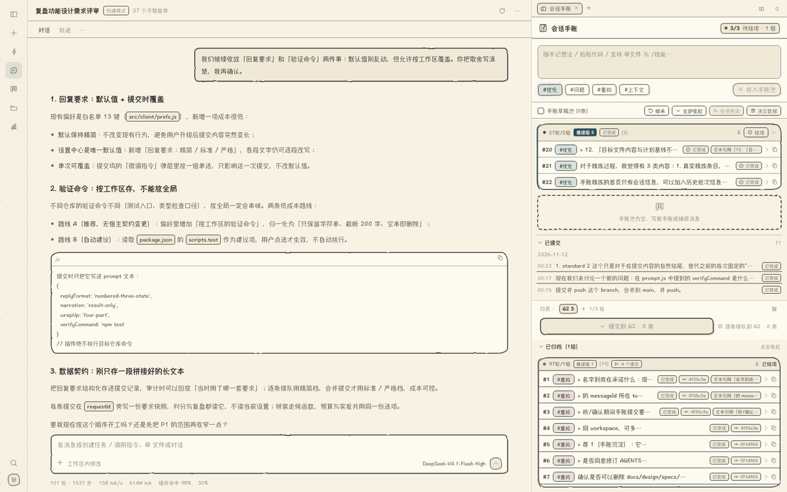
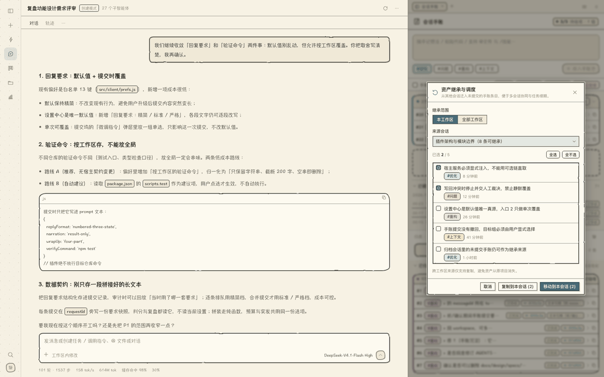
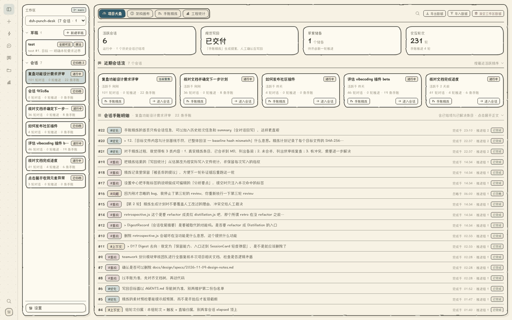
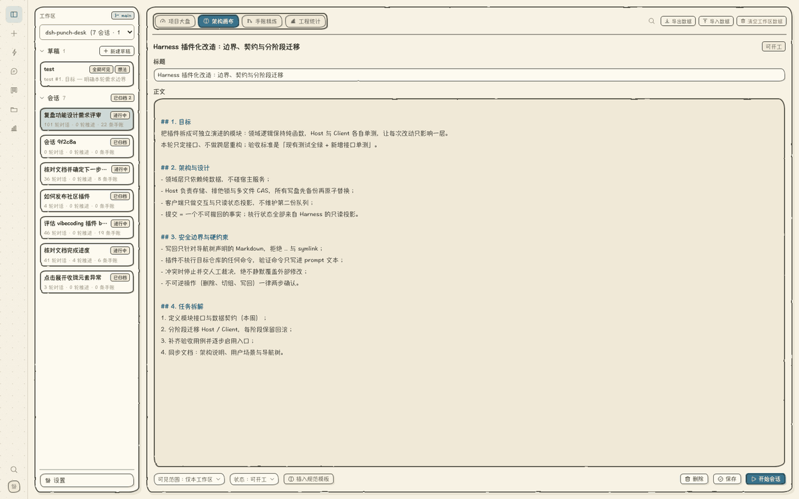
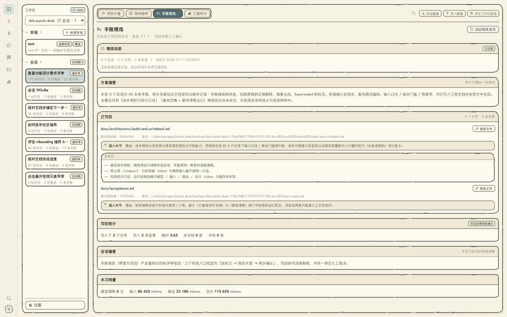
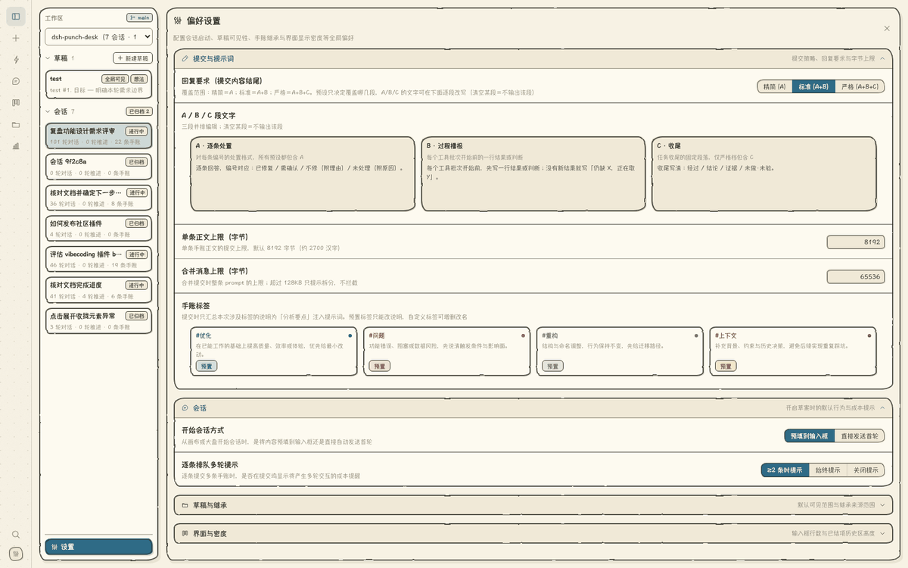

<p align="center">
  
</p>

<h1 align="center">会话手账 · Punch Desk</h1>

<p align="center"><b>让 Prompt 告别即用即弃：把会话里的火花，变成沉淀进代码库的规范。</b></p>

<p align="center">
  <a href="https://github.com/deepseek-ai/deepseek-harness">= 0.2.2-rc.1" src="https://img.shields.io/badge/DeepSeek%20Harness-%3E%3D0.2.2--rc.1-orange?style=flat-square"></a>
  <a href="https://github.com/Allencccc/dsh-punch-desk/blob/main/LICENSE"></a>
  
</p>

<p align="center">
  <a href="#三步上手">安装与上手</a> ·
  <a href="#界面预览">界面预览</a> ·
  <a href="#常见问题">问答</a> ·
  <a href="https://github.com/Allencccc/dsh-punch-desk/blob/main/README.en.md">English</a>
</p>

## 它是什么

DeepSeek Harness 的会话手账插件。它把 Prompt 当作推进工程落地的「流动工作项」，而不是即用即弃的聊天：

- **开工前**：在 4 段式 Spec 画布推演目标、架构、安全边界和任务拆解；
- **会话中**：随手记、把模型回复里的关键点捕获成手账，在待办池里改好，再合并或逐条交给模型；
- **收尾时**：从已解决的手账里提炼决议（已忽略仅作「曾被否决」上下文，不写成规则），人工两级勾选确认后多文件 CAS 写回工程文档体系（`docs/`、`AGENTS.md` 等，目标面由项目 `AGENTS.md` 文档导航声明）；该能力已实现（含取消/维护窗口/幂等指纹），已通过端到端验收。

一个插件，两个入口：

- **Desk**：左侧栏进入的全局工作台，管多个工作区、草稿、会话大盘和手账精炼（已交付，已通过端到端验收）；
- **Session Pane**：会话右侧抽屉，管当前会话的随手记、待办手账和推进组。

所有数据只存在本机，不上传云端；插件本身不需要任何模型 API Key，使用你在 DSH 里已经配置好的模型。

## 界面预览



*入口 2 · Session Pane：随手记与消息捕获进入草稿池，拖进推进组后选择合并提交或逐条排队；顶部汇总未结项数量与执行状态。*



*资产继承与调度：从其他会话迁入未提交的手账条目，可选本工作区 / 全部工作区；跨工作区的来源只能复制。*



*入口 1 · Desk 项目大盘：工作区与会话清单、活跃会话 / 规范写回 / 草案储备 / 交互轮次四项指标、近期会话卡片，以及按会话展开的手账明细。*



*架构画布：目标 / 架构 / 安全边界 / 任务拆解四段式草案，可一键插入规范模板，并选择「预填到输入框」或「直接发送首轮」开启会话。*



*手账精炼：从会话批次提炼文档更新提案，逐条确认后经多文件 CAS 校验写回，并保留方案摘要、写回统计与本次用量。*



*设置中心：回复要求预设与 A/B/C 段文字、单条正文与合并消息的字节上限、手账标签，以及会话、草稿、界面密度等全局偏好。*

## 两个入口

### 入口 1 · Desk 全局工作台

- **多工作区切换**：每个工作区独立统计会话、草稿和 Git 信息；
- **项目大盘**：活跃会话、文档写回概况、草案储备、累计交互轮次与手账明细；
- **Spec 画布**：4 段式架构推演模板，一条草稿可直接开启新会话（预填或自动发送首轮 Prompt）；
- **手账精炼**：从手账与会话上下文提炼候选决议，生成工程文档体系（`docs/` 等）的更新提案，人工两级勾选确认后写回（已实现，已通过端到端验收）；
- **工程统计**：手账分类、会话轮次分布、规范沉淀转化率；
- **全局设置**：Desk 左下角常驻入口，集中配置启动方式、逐条排队提示、草稿默认可见范围、继承范围、随手记输入框行数与已结项历史区高度，修改即保存并支持恢复默认；
- **Git 归属反查**：Desk 页头提供 Git Commit 归属查询，输入 7–40 位 commit hash 前缀即可反查关联的手账与会话并一键打开；
- **草稿可见范围**：每条草稿可选择「全局可见」或「仅本工作区可见」，新建默认仅本工作区；
- **安全重置**：按分类清空当前工作区数据，支持保留锁定资产；
- **数据迁移**：一键导出全部数据为 JSON 备份；导入支持「合并」（按 id 去重、新者优先）与「覆盖」（先自动备份当前库再重建）。

### 入口 2 · Session Pane 会话手账抽屉

- **随手记**：随时记录想法；支持 `/` 指令、`@` 文件引用、`$` 会话历史；
- **精准捕获**：助手消息工具栏一键捕获，划词选区引用，自动带消息锚点；
- **待办手账池**：自由编辑、合并、删除；草稿池里未提交的手账可拖进推进组；
- **Active Group 推进**：合并为一条复合 Prompt，或逐条排队；模型开始执行前可原地修改排队文本（提交无撤回）；
- **Turn 级 Git 区间归属**：自动记录每次手账提交 Turn 区间（`preHead..postHead`）内产生的 Git commits，在手账卡片与推进组头部汇总展示（完成时 HEAD 快照作为次级信息）；
- **结项闭环**：一个会话最多 3 个未结项推进组，结项后释放名额并进入历史；
- **复核语义**：行状态区分「已完成 / 已忽略」；`queued` / `running` 行需等 Turn 结束后才可复核；批次未完成时「结项」按钮为禁用态（`tip` 说明原因）；提交无撤回，Fork 仅适用于已执行/已复核的行；含忽略的批次显示「已处理 · 含忽略 / 全部忽略」，但仍需显式结项才释放 3 组名额；结项只结算静态行，已忽略条目保持原样。
- **资产继承**：从其他会话调度未提交手账（Move / Copy），**已归档会话里未提交的手账也可以捞出来**；继承范围可切「本工作区 / 全部工作区」，**跨工作区来源只允许复制**（避免资产从原项目消失），并保留继承血缘；
- **归档投影**：Harness 里归档的会话在 Desk 默认隐藏并显示归档计数；当前会话被归档时显示「已归档」并锁定提交。

## 三步上手

### 1. 安装

要求 DeepSeek Harness **`>= 0.2.2-rc.1`**（Desktop 或 Web 版均可）。

本插件已发布到 npm，也可以使用离线包或本地目录安装：

**方式 A · npm**

```bash
dsh plugin --profile <profile名> add dsh-punch-desk@1.0.0 --registry=https://registry.npmjs.org/
```

如果 pnpm 默认 registry 不是 npmjs，保留 `--registry`；DSH 会原样转发给 pnpm。

**方式 B · 插件页（离线包）**

1. 拿到 `dsh-punch-desk-<版本>.tgz`（用仓库里的 `npm pack` 生成，或直接用别人分享的离线包）；
2. DSH 左侧栏「**插件**」→「**添加插件**」；
3. 输入 `.tgz` 的**绝对路径**（也可以填解压后的插件目录绝对路径），点安装；
4. 确认 Punch Desk 组合包已启用，**硬刷新浏览器**（Cmd+R / Ctrl+R）。

**方式 C · 命令行（离线包）**

```bash
dsh plugin --profile <profile名> add /绝对路径/dsh-punch-desk-<版本>.tgz
```

装完在「插件」页选中并启用 Punch Desk；若 DSH 没有 HMR，重启客户端。

**方式 D · 从源码安装（想改代码时，需要 Node.js `>= 22.19.0`）**

```bash
git clone https://github.com/Allencccc/dsh-punch-desk.git
cd dsh-punch-desk
npm install && npm run build
```

然后在「插件」页用「添加插件」填该目录的**绝对路径**（本地目录会以 link 方式接入；改代码后重新构建并重启 DSH）。

- **更新**：先移除旧版再安装新包；npm 安装可直接重新执行 `dsh plugin ... add dsh-punch-desk@<版本>`；源码目录方式直接重新构建/重启。
- **卸载**：「插件」页移除 Punch Desk。你的手账数据不会被删除。
- **数据位置**：`~/.dsh/storages/punch_desk.json`；文档写回备份在 `~/.dsh/storages/punch_desk/backups/`。

### 2. 打开两个入口

- 左侧导航栏点击 Punch Desk 品牌图标 → **Desk 工作台**；
- 打开任意会话，点击右侧栏的 Punch Desk 标签 → **会话手账抽屉**。

### 3. 走完一条手账

1. 在 Desk 的 Spec 画布写一条 4 段式草稿，选择「仅本工作区」或「全局可见」；
2. 点「以此草案开启会话」（预填或自动发送）；
3. 会话中把模型回复里的关键点捕获成手账，放进待办池；
4. 选中手账，拖进推进组，用「合并提交」或「逐条排队」交给模型；
5. 全部执行完后点「结项」，进入历史；
6. 到 Desk 的「手账精炼」提炼决议，人工确认后写回工程文档体系（已实现，已通过端到端验收）。

## 一条手账的旅程

按时间顺序，一条手账会经过 5 个时刻：

| 时刻 | 你做什么 | 系统发生什么 |
|---|---|---|
| 1 记下来 | 随手记，或从消息/选区捕获 | 手账进入待办池，状态仍是「未提交」，可以继续改 |
| 2 交给模型 | 拖进推进组，选「合并提交」或「逐条排队」 | 插件把内容交给 DSH queue；目标组必须由你显式选择 |
| 3 执行 | 等待 | Harness 执行 turn；界面只读显示排队/执行中/已完成，插件不调度、不自动补交 |
| 4 验收 | 单条「解决/忽略」，或整组「结项」 | 组释放名额、进入历史；已执行内容锁定为审计记录 |
| 5 下一轮 | 对已执行/已解决条目「Fork」 | 新条目回草稿池，保留上一轮血缘，可重新编辑/提交 |

```text
捕获/随手记 → 待办手账池 → 推进组 → Harness Turn → 复核/结项 → Fork 下一轮
```

> 组头徽章目前显示「会话经过 N 轮 / G组」，不是该组独占的工作量；按组归属/触发统计的轮次口径在后续版本规划中。

## 用户场景

13 条已交付核心用户旅程（草稿开局、引用捕获、合并/逐条提交、排队原地编辑与消费后只读、轻量摘要续期、全局浏览、已提交回看、推进组调度、全局偏好设置、Commit 区间归属与反查、组轮次归属与归档冻结），逐条验收状态见 [docs/user-cases.md](https://github.com/Allencccc/dsh-punch-desk/blob/main/docs/user-cases.md)。

## 关键行为

- **提交是二态事实**：手账只区分「未提交 / 已提交」。排队、执行中、已完成是 Harness 的只读状态，不是插件的队列。
- **未执行前皆可改**：草稿池和排队中的手账，只要模型还没开始执行，都可以自由修改内容（提交无撤回）；执行后锁定为审计历史。
- **排队交给 Harness**：插件只负责把选中的手账交给 DSH 的 queue，不维护自己的调度器，不会自动补交。
- **3 个活跃组上限**：一个会话最多同时 3 个未结项推进组；结项后释放名额。
- **归档不是删除**：Harness 归档的会话会被隐藏、不能推进，但其中的未提交手账仍然可以继承出来继续做。
- **写回可回滚（手账精炼，已交付）**：文档写回经过人工逐条确认、多文件 CAS 防冲突校验与读回验证，写前自动备份。

## 常见问题

### 数据存在哪？会上传吗？

全部在本机：手账、Prompt 审计、草稿、推进组和规范备份都在 `~/.dsh/storages/punch_desk.json` 与旁边的 `backups/` 目录。没有云端账号系统，插件不会把它们上传到别处。

### 需要另外配模型 API Key 吗？

不需要。插件本身不调用模型；所有生成都走你在 DeepSeek Harness 里已经配置好的模型。

### 为什么新建草稿默认只有本工作区可见？

避免在 A 项目写的想法漏到 B 项目。草稿编辑器里可以随时改成「全局可见」，历史草稿默认按全局兼容。

### 为什么有些手账在 Desk 里看不到？

对应会话可能已在 Harness 中归档，Desk 默认隐藏归档会话并显示归档计数。取消归档后会话会重新出现；归档会话里未提交的手账仍可通过「资产继承」调度出来。

### 右侧没有 Punch Desk 标签 / 界面没变化？

先确认「插件」页里 Punch Desk 已启用，然后**硬刷新**浏览器（Cmd+R / Ctrl+R）；更新过客户端代码需要重装 bundle 并重启 DSH。仍不显示时检查 DSH 版本是否满足 `>= 0.2.2-rc.1`。

### 最多能开几个推进组？

3 个未结项组。结项（Batch Wrap-up）后释放名额；组内未提交的手账可以移出或退回草稿池。

### 卸载会删除我的数据吗？

不会。卸载只移除插件；`~/.dsh/storages/punch_desk.json` 需要你手动删除。删除前建议先备份。

## 已知限制

以下为已接受的非阻塞缺口，列出来是为了避免误解（不是待办承诺）：

- **归档会话组合**：手账精炼支持选择已归档会话，但「含已归档会话」的真实端到端批次目前只有自动化测试覆盖。
- **会话标题**：精炼素材预检的标题来自宿主的 `session/title` 事件；事件缺失时回落到本地记录的标题。
- **基线漂移重对齐**：`rebase` 只重对齐计划，不重算计划内的静态校验结果；写回时会重新校验，冲突会阻断并提示。
- **变更原文**：变更预览里的「原文」只覆盖第一轮建议过的文件，其余目标显示「未抓取到原文」。
- **暂存**：暂存会释放提交锁；若长时间不处理，仍按 24 小时 TTL 过期提示，不会自动写回。

## 开发

```bash
npm ci
npm test            # node --test，全量自动化测试
npm run build       # esbuild 打包 client.js
npm pack            # 生成可分发的 .tgz
```

- 贡献指南：[CONTRIBUTING.md](https://github.com/Allencccc/dsh-punch-desk/blob/main/CONTRIBUTING.md)
- 安全问题报告：[SECURITY.md](https://github.com/Allencccc/dsh-punch-desk/blob/main/SECURITY.md)
- 变更记录：[CHANGELOG.md](https://github.com/Allencccc/dsh-punch-desk/blob/main/CHANGELOG.md)
- 界面预览：[`docs/mockup/previews/`](https://github.com/Allencccc/dsh-punch-desk/tree/main/docs/mockup/previews)
- 英文手册：[README.en.md](https://github.com/Allencccc/dsh-punch-desk/blob/main/README.en.md)

## License

[MIT](https://github.com/Allencccc/dsh-punch-desk/blob/main/LICENSE)
